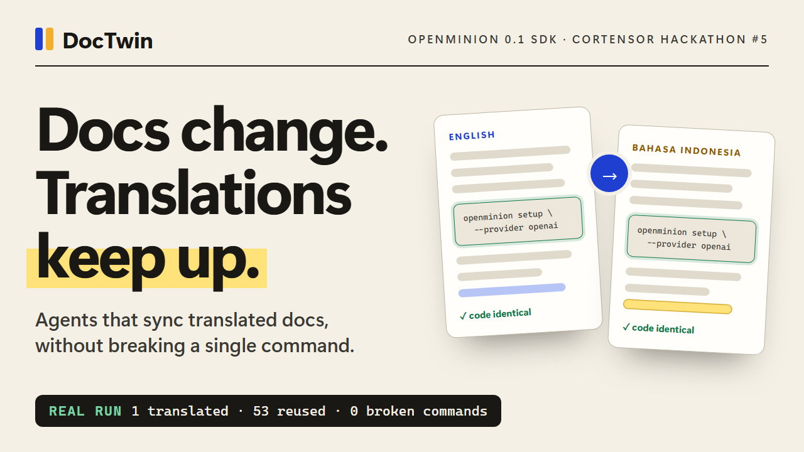
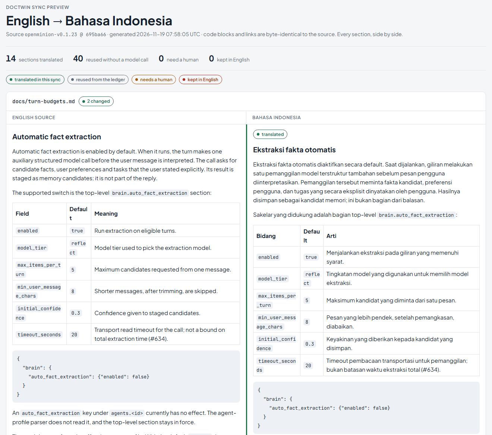

# DocTwin

Keep translated docs in sync with the English source, without breaking a single
command, link or code block.

DocTwin is a set of OpenMinion agents. When the English docs change, it
re-translates only the sections that changed and checks each one twice: with
deterministic gates (rule-based checks, no model involved) and with a reviewer
subagent (a second agent that checks the meaning). A section that fails stays
in English rather than ship a wrong translation. DocDrift, the checker this repo is named
after, runs at the end of every sync and tests each command and import in the
translation against the real SDK.

Built on the OpenMinion 0.1 Python SDK for Cortensor Hackathon #5. While
building it we found bugs in the SDK and fixed two of them:
[openminion#810](https://github.com/openminion/openminion/pull/810) was
merged and shipped in openminion 0.1.24, and
[openminion#869](https://github.com/openminion/openminion/pull/869) was merged into `dev`
for the next release.

[](https://youtu.be/YquM4dqjr7M)

**Demo video (3:22):** <https://youtu.be/YquM4dqjr7M>. Its terminal scenes are cut from a real screen
recording, [`demo/screen-recording.mp4`](demo/screen-recording.mp4) (2:25, uncut).
[`demo/README.md`](demo/README.md) says what was edited and what was not. The
video was recorded before our first complete Portal sync, so its Portal part is
out of date; see [Cortensor Portal and Gemma4](#cortensor-portal-and-gemma4).

## Results

Measured on OpenMinion's own docs, translated into Bahasa Indonesia. The
numbers come from the sync reports in `translations/id/.doctwin/reports/` and
[`demo/logs/sync-report.md`](demo/logs/sync-report.md).

| Sync | Sections sent to the model | Time, start to finish | Token cost |
| --- | --- | --- | --- |
| First translation, v0.1.18 | 47 of 47 | 20 min | about $0.55 |
| Update to v0.1.23 | **14 of 54** (40 reused) | 12 min | about $0.31 |
| One changed sentence (the demo run) | **1 of 54** | 32 s | under $0.01 |
| The same change on Cortensor Portal, `oss-20b` | **1 of 54** | 7 min 15 s | free plan |

In every sync, every code block came out byte-identical to the source and no
command or import was broken. Two sections the model got wrong were refused
by the gates and stayed in English until a later sync got them right. Costs
are for `gpt-4.1-mini` at $0.40 per million input tokens, $0.10 per million
cached input tokens, and $1.60 per million output tokens. The Portal run is in
[`evidence/portal/doctwin-sync-oss-20b/`](evidence/portal/doctwin-sync-oss-20b/).

Each sync also writes a side-by-side preview. This is one section from the
update to v0.1.23: the table keeps its shape, the values and the issue number
are unchanged, and the code block is byte-identical.



## Submission checklist

| Hackathon item | Where |
| --- | --- |
| Setup and run instructions | [Try it](#try-it) |
| OpenMinion SDK workflow | [How a sync works](#how-a-sync-works) and [What it uses from OpenMinion](#what-it-uses-from-openminion) |
| Working example | [Try it](#try-it): a one-section sync, the same run the video records |
| Demo video, 1 to 5 minutes | <https://youtu.be/YquM4dqjr7M> |
| Building Blocks Tested | [BUILDING_BLOCKS.md](BUILDING_BLOCKS.md) |
| What We Learned | [WHAT_WE_LEARNED.md](WHAT_WE_LEARNED.md) |
| Bug reports and fix PRs | [openminion#803](https://github.com/openminion/openminion/issues/803), fixed by [openminion#810](https://github.com/openminion/openminion/pull/810): merged, shipped in 0.1.24. [openminion#804](https://github.com/openminion/openminion/issues/804), part 1 fixed by [openminion#869](https://github.com/openminion/openminion/pull/869): approved and merged into `dev` |
| Portal and Gemma4 testing | a complete one-section sync on Portal ([evidence](evidence/portal/doctwin-sync-oss-20b/)), and every run in [WHAT_WE_LEARNED.md](WHAT_WE_LEARNED.md), Part D |

## Why

Docs change with every release. Translations don't keep up, and when someone
does re-translate a page, a command or a number often gets "translated" too. A
stale or subtly wrong translation is worse than none.

DocTwin does one job, repeatably: when the English docs change, it updates the
translation only where the source changed, guarantees the code survives
untouched, and tells a human exactly which parts still need their eyes.

The Indonesian translation is in [`translations/id/`](translations/id/), with
a report for each sync under `translations/id/.doctwin/reports/`. Besides the
two syncs in [Results](#results), two small reports re-sync 3 sections after we
tightened the protection rules (WHAT_WE_LEARNED.md, B6). Every link and the
heading structure match the source as well.

The two sections "kept in English" show the gates at work. On the first
sync the model turned `33.76` into `33,76` (the Indonesian decimal comma) in a
table of measurements, and dropped one section from its answer. The gates
refused both, so those sections stayed in English instead of shipping wrong.
Both went through cleanly on the next sync.

## How a sync works

```
English docs (any git ref)
   │
   ├─ split into sections, compare with the ledger (a fingerprint of every
   │  section from the last sync) ──► unchanged sections are reused
   │
   ▼  changed sections only
 protect    code, inline code, URLs, HTML and quoted program output become
            placeholders (⟦CODE1⟧, ⟦IC2⟧, ...) the model cannot touch
 translate  translator agent, with a glossary lookup tool
 gate       placeholders, heading level, numbers, list items, table shape,
            glossary terms, length. Fail → one retry, with the gate errors sent
            back to the model
 review     a skeptical reviewer subagent checks meaning, negations, numbers.
            Reject → one repair attempt, then the section is marked "needs review"
 write      placeholders restored byte for byte, file written, ledger updated
 glossary   the glossary keeper agent proposes new terms; a term is written only
            if a human approves it
 validate   DocDrift checks every command and import in the output against the SDK
```

A few things follow from this design:

- **The model never sees code**, so it cannot break it. Each report also
  verifies that code blocks are byte-identical to the source.
- **Only changed sections cost anything.** The ledger, `.doctwin/ledger.json`,
  stores a fingerprint of every section, so unchanged ones are reused without
  a model call.
- **Hand edits are respected.** If a person edits a translated file, DocTwin
  notices and leaves that file alone unless you pass `--force`.
- **Wrong output is never accepted silently.** A section that fails the gates stays in
  English. A section the reviewer rejects is marked
  `<!-- doctwin: needs review -->` and listed in the report.

## Try it

You need Python 3.12+, [uv](https://docs.astral.sh/uv/), git, and an OpenAI API
key. Every run in this repo used `gpt-4.1-mini`. Other OpenMinion presets, such
as Gemini, are a config switch, but we did not test them.

```bash
git clone https://github.com/bagusardin25/openminion-docdrift.git doctwin && cd doctwin
uv sync                                 # installs openminion 0.1.23, the version every run here used
                                        # (our fix shipped later, in 0.1.24)
cp .env.example .env                    # add OPENAI_API_KEY
uv run docdrift init --provider openai  # writes .openminion/agents.json; the key stays in .env

uv run doctwin fetch --ref v0.1.23
uv run doctwin plan --source .cache/openminion-v0.1.23   # what would be translated (no model)
uv run doctwin sync --source .cache/openminion-v0.1.23   # translate, gate, review, write
```

The repo already contains the Indonesian translation and its ledger, so `plan`
reports nothing to do. To watch a real incremental sync for about a cent:

```bash
uv run python scripts/make_demo_source.py   # v0.1.23 docs with one sentence changed
uv run doctwin sync --source .cache/demo-source --out .cache/demo-twin
```

That re-translates exactly one section out of 54, and it is the run the demo
video records. Each sync writes `report.md` and a side-by-side `preview.html`
(English left, translation right) into the `.doctwin/` folder of the output.

The same sync runs on Cortensor Portal too, for free but slower (ours took 7
minutes). Put `CORTENSOR_API_KEY` in `.env`, then:

```bash
uv run python scripts/make_demo_source.py   # a fresh copy of the translation to sync into
uv run docdrift init --provider cortensor-portal --model oss-20b --agent docdrift-portal
uv run doctwin sync --source .cache/demo-source --out .cache/demo-twin --agent docdrift-portal --no-tools --terms skip --timeout 900
```

We use `--no-tools` because Portal returns an HTTP 502 error when the model
sends a malformed tool call. We use `--terms skip` because the glossary keeper
needs a tool call, and tools are off. `init` also turns off OpenMinion's
automatic fact extraction (an extra model call on every turn) and gives Portal
a 900 s timeout. These are the settings our run used.

Useful options for `sync`: `--lang` (default `id`), `--file` to pick files,
`--terms ask|yes|no|skip` for glossary approvals, `--no-tools` for providers
with weak tool calling, `--dry-run`, and `--force`.

Other languages: `--lang es`, `pt` or `vi` writes to `translations/<lang>/` with
its own ledger and glossary. Only Indonesian has been run end to end, and only
Indonesian has a starter glossary; a new language starts with an empty one and
fills it through approvals. The length gate accepts 0.6 to 2.2 times the
source length in characters. Chinese, Japanese and Korean use far fewer
characters, so they would need a different gate first.

Tests need no API key: `uv run pytest`.

## What it uses from OpenMinion

| SDK feature | Where |
| --- | --- |
| `Agent` with `output_type` (Pydantic) | translator and reviewer return validated batches |
| `@tool(min_scope="READ_ONLY", idempotent=True)` | `glossary_lookup` runs without prompts |
| default-scope `@tool` + `approval_callback` | `add_glossary_term` writes only after a human says yes |
| `forced_tools` | the glossary keeper must go through that approval-gated tool |
| `subagent` | the reviewer, with its own instructions, output type and timeout |
| sessions, `ProviderError`, `TurnTimeoutError`, `run_id` | one session per sync, and a per-turn diagnostics table in every report |

Providers are a config switch (`docdrift init --provider ...`); the agent code
does not change.

## DocDrift

The repo is called `openminion-docdrift` because that is where we started.
DocDrift checks docs against the installed SDK without a model: every
`openminion ...` command against the real `--help`, every Python snippet
against the installed package, every `OPENMINION_*` variable against the
source.

```bash
uv run docdrift fetch && uv run docdrift scan    # OpenMinion docs vs the installed SDK
uv run docdrift scan --docs path/to/project      # any project built on OpenMinion
uv run docdrift run                              # adds agent triage and claim checks
```

It found no problems in the 0.1.23 docs, and real drift when the same docs meet
older releases (0.1.10 and 0.1.15). We then built DocTwin on top of it, and
DocDrift became its safety net: it validates every translation. Its reports
are in [`evidence/docdrift/`](evidence/docdrift/).

## What we found along the way

Details, with file and line references, are in
[WHAT_WE_LEARNED.md](WHAT_WE_LEARNED.md). Per-feature results are in
[BUILDING_BLOCKS.md](BUILDING_BLOCKS.md).

- **`AgentOutputValidationError` hid the real cause of a failure.** Reported as
  [openminion#803](https://github.com/openminion/openminion/issues/803). The
  maintainers confirmed it, and our fix,
  [openminion#810](https://github.com/openminion/openminion/pull/810), was
  merged and shipped in openminion 0.1.24.
- **A user message over 12,000 characters returns a canned reply marked
  `completed`.** The reply is a fixed text built into OpenMinion, not a model
  answer, so callers cannot tell it apart. Reported as
  [openminion#804](https://github.com/openminion/openminion/issues/804), where
  the maintainer also corrected part of our analysis. The maintainer accepted
  the first part of our proposed fix, and our PR [openminion#869](https://github.com/openminion/openminion/pull/869)
  gives the most common case, an oversized new request, its own reason and a
  question that says what happened. It is approved and merged into `dev`; the
  rest of the issue stays with the maintainers.
- **`Agent(output_type=...)` never sends the schema to the model.** We measured
  how often replies were valid with and without our workaround. Another builder
  reported the same gap as
  [openminion#853](https://github.com/openminion/openminion/issues/853), so we
  added our numbers to that issue instead of opening a duplicate.
- **One model reviewing itself approves everything.** Our first reviewer confirmed
  four findings that were all wrong. Handing it deterministic facts and asking
  it to disprove fixed that.

### Cortensor Portal and Gemma4

We tested Portal with a free-plan key, following its Quick start. Called
directly, the API works: tool calls, forced `tool_choice`, and even the exact
request OpenMinion sends, on both `oss-20b` and `gemma4`.

Full OpenMinion turns were harder. Our first seven attempts (2026-11-21)
failed, each for a logged reason: intermittent stalls, a gateway error (HTTP
502) when the model's tool arguments did not match the schema, and prose
instead of JSON. On 2026-11-23 a
complete DocTwin sync of one section ran on Portal with `oss-20b`, with no
tools and fact extraction off, so each turn made one provider request. It took
7 minutes, passed the gates and the reviewer, and kept the code block
byte-identical ([evidence](evidence/portal/doctwin-sync-oss-20b/)). The same sync on `gemma4` stalled on all
three attempts, and DocTwin kept that section in English ([evidence](evidence/portal/doctwin-sync-gemma4/)).
The larger syncs ran on `gpt-4.1-mini`,
because a Portal request takes minutes. Every run, with request IDs, is in
[WHAT_WE_LEARNED.md](WHAT_WE_LEARNED.md) Part D, and the raw logs are in
[`evidence/portal/`](evidence/portal/).

## Dependencies

- Runtime: [`openminion`](https://pypi.org/project/openminion/) 0.1 and `pydantic`. Tests: `pytest`.
- A model: any OpenMinion provider preset. The runs here used OpenAI `gpt-4.1-mini`.
- For the demo video only: ffmpeg (through `imageio-ffmpeg`), Pillow, NumPy, Edge or Chrome, Windows
  Terminal, and OpenAI text-to-speech for the voice-over.

## Repository

```
src/doctwin/     sync, gates, ledger, glossary, agents, preview
src/docdrift/    command, snippet and env-var checks, plus the triage agents
tests/           20 tests, no model needed
translations/    the Indonesian docs DocTwin produced, with ledger and reports
evidence/        logs and reports from the real runs
upstream/        the issue texts, PR descriptions, patch and release check we sent to OpenMinion
scripts/         helpers: the one-sentence demo source, and re-syncing after a rule change
demo/            the raw screen recording, the thumbnail, and the scripts that build the demo video
```

The translations are unofficial. Attribution for the Apache-2.0 originals is in
[`translations/NOTICE.md`](translations/NOTICE.md).

## License

MIT
